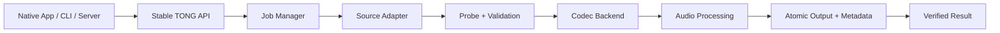

# 🔊 TONG AUDIO ENGINE

### Convert. Process. Integrate. Everywhere.

**An open-source, UI-free, cross-platform audio conversion engine.**

**Android · iOS · Windows · macOS · Linux · Headless servers**

[Architecture](docs/ARCHITECTURE.md) · [Features](docs/FEATURE_MATRIX.md) · [Integrations](docs/INTEGRATION_SPEC.md) · [Roadmap](docs/ROADMAP.md) · [Wiki source](wiki/Home.md)

---

> [!IMPORTANT]
> **Development status — experimental CLI and architecture specification.** This repository documentation describes **planned capabilities**, not a finished or verified converter. The project will ship working, tested components incrementally. No UI, dashboard or mobile app will be built as part of the engine itself.

## Why TONG Audio Engine?

Applications should not need to reinvent media pipelines, codec handling, error recovery or platform integration for every operating system. **TONG Audio Engine** is designed as one reusable backend with a stable API and interchangeable source/codec adapters.

- **Universal conversion:** MP3, WAV/PCM, FLAC, AAC/M4A, Opus, Ogg/Vorbis, AIFF and more, depending on installed codecs/build.
- **Video-to-audio extraction:** Where permitted, accept compatible media containers such as MP4, MOV, MKV and WebM.
- **Quality control:** Bitrate, sample rate, channels, lossless options, tags and loudness processing.
- **Reliable jobs:** Persistent queue, progress, cancellation, retries, atomic output writes and structured diagnostics.
- **No UI dependency:** Embed via C ABI/native SDKs or use CLI and optional REST worker.
- **Modular sources:** Local files first; authorized direct URLs and optional externally maintained extractors later.
- **Device-first:** Perform conversions locally where supported; use a server worker only when required.
- **Inspectable:** Reproducible builds, tests, codec capability reports, security checks and third-party notices.

## At a glance

| Layer | Design | Scope |
|---|---|---|
| Engine orchestration | Rust | Job lifecycle, policies, errors, queue |
| Decode/encode | FFmpeg libraries or process adapter | Broad codec support, licensed per build |
| Probe / metadata | FFprobe + optional Symphonia | Stream validation, tags, duration |
| Processing | FFmpeg filters + optional Rubato/dasp | Resampling, loudness, trimming, channels |
| Sources | Versioned source adapters | File, permitted direct URL, opt-in extractors |
| Integration | C ABI + Kotlin/Swift/C#/Python wrappers | Native app integration |
| Automation | CLI + optional authenticated REST worker | Desktop and headless deployments |

**Not all layers ship in the first release.** See the [versioned roadmap](docs/ROADMAP.md).

## Format plan

| Input examples | Output examples | Note |
|---|---|---|
| MP3, WAV, FLAC, OGG, M4A, AIFF | MP3, WAV, FLAC, OGG, M4A, AIFF | Depends on selected codec build |
| MP4, MKV, MOV, WebM | Audio formats above | Extracts only accessible audio streams |
| Permitted direct media URLs | Audio formats above | Controlled by source/network policies |
| Optional provider source | Audio formats above | May be blocked/restricted independently of conversion |

**Converting lossy audio to lossless does not restore lost quality.** Output bitrate and achievable quality depend on source content.

## Architecture sketch

## Integration model

- **Android:** Rust native library + Kotlin JNI wrapper; no mandatory Python runtime.
- **iOS:** Embedded native libraries via C ABI/Swift wrapper, respecting App Store and codec license rules.
- **Windows / macOS / Linux:** Library or CLI subprocess; select least complex safe deployment option.
- **Server:** Optional queue worker and authenticated REST endpoint; not required for standalone operation.

We will **not** claim that every platform uses the exact same binary. The engine's **API contract and behavior** are portable; architecture-specific artifacts are compiled separately.

## Source adapters and platform restrictions

TONG Audio Engine separates **acquisition** from **conversion**. A URL extractor can fail because of provider policy, availability, authorization or a streaming protocol change, while local MP3/WAV conversion remains unaffected. Optional YouTube support must respect applicable rights, access permissions and service terms. Neither unrestricted downloads nor bypass of DRM/access controls is promised.

## Open-source licensing

Original TONG-owned code is published under the **Apache License 2.0**. This does **not** relicense FFmpeg, GStreamer, Symphonia, yt-dlp, codecs or other dependencies. Some FFmpeg builds are LGPL; enabling GPL components changes distribution obligations. Review [third-party license compliance](docs/LICENSE_COMPLIANCE.md) before publishing binaries.

## Experimental CLI (first implementation)

The repo now includes a **working-source headless Rust CLI** for permitted local files, with FFmpeg/FFprobe as installed dependencies. **Not yet production-ready or a mobile SDK.** Run `cargo build --release` and use `cargo run -- convert --input voice.wav --output voice.mp3 --bitrate 192k`. See [CLI commands and limitations](docs/CLI.md).

## Contributing

Read [CONTRIBUTING.md](CONTRIBUTING.md) and the [technical roadmap](docs/ROADMAP.md). Suggestions and compatibility reports are welcome; please include test media you own or may redistribute.

## Security

Please do not post credentials, cookies, access tokens or private media URLs in public issues. See [SECURITY.md](SECURITY.md).

---

Made for open integration by **ParmTech** · Project: **TONG Audio Engine**
