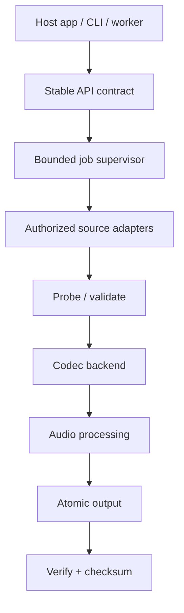

# Architecture

[← Home](Home.md)

The central orchestration layer is planned in Rust, exposing a C ABI and thin platform wrappers. FFmpeg provides practical broad conversion capabilities; third-party URL extractors remain optional and independent.

Read the [full architecture specification](https://github.com/parmtech/tong-audio-converter/blob/main/docs/ARCHITECTURE.md).
