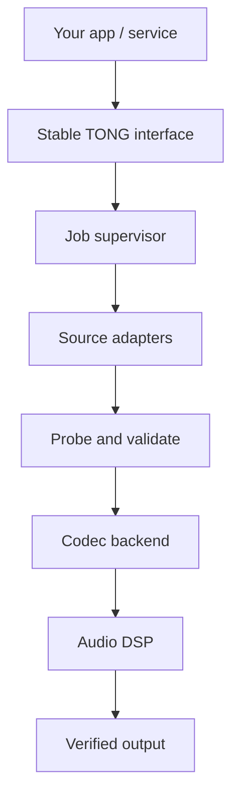

# 🎧 TONG AUDIO ENGINE

## The Developer Wiki

**ONE ENGINE · MANY FORMATS · EVERY PLATFORM**

_A modular, headless audio extraction, transcoding and processing platform._

[🏠 Project](https://github.com/parmtech/tong-audio-converter#readme) · [🧭 Architecture](Architecture.md) · [🎛️ Formats](Audio-Formats.md) · [🔌 Integrations](Integrations.md) · [❓ FAQ](FAQ.md)

---

> [!NOTE]
> **Status: Under development.** This Wiki introduces the engineering blueprint and the public roadmap. It does not claim that downloads, native SDKs or conversion binaries are already available.

## Start here

| 📘 Learn | 🔧 Build | 🚀 Extend |
|---|---|---|
| [Project overview](Getting-Started.md) | [System architecture](Architecture.md) | [Integrations & API](Integrations.md) |
| [Audio format guide](Audio-Formats.md) | [Open-source inspirations](Third-Party-Research.md) | [FAQ and known limits](FAQ.md) |

## What is TONG Audio Engine?

TONG Audio Engine is an **open-source backend component** that aims to make audio conversion reusable in almost any application. Instead of building yet another desktop converter interface, it exposes conversion functions to other software through native SDKs, CLI, and optional remote APIs.

### What it is designed to do

**🎼 Convert:** MP3 ↔ WAV ↔ FLAC ↔ AAC/M4A ↔ Opus ↔ OGG/Vorbis and many additional supported codecs.

**🎬 Extract:** Take existing audio streams from compatible video containers such as MP4, MOV, MKV and WebM.

**🎚️ Process:** Bitrate, resampling, stereo/mono, normalization, trimming and metadata.

**⚙️ Automate:** Jobs, queues, progress, resume policies, input validation and machine-readable diagnostics.

**🔌 Integrate:** Android, iOS, Windows, macOS, Linux and optional servers—without shipping a built-in graphical UI.

## System overview

## Philosophy

**Simple by default. Powerful by extension.** Local offline conversion should continue to work even if a third-party website changes its streaming delivery. Actual supported features are defined by each release's compiled codec manifest, not marketing promises. Public contributions must respect licenses, media rights and platform policies.

---

**TONG AUDIO ENGINE** · An open project by **ParmTech**
